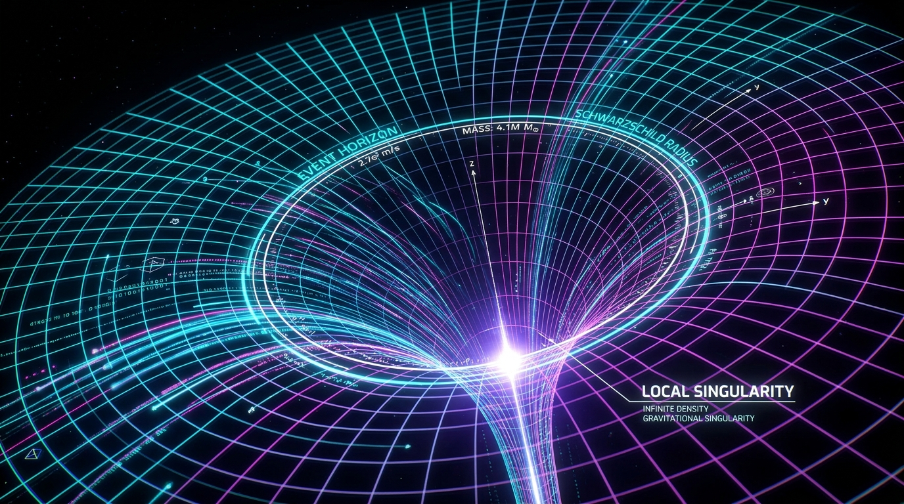
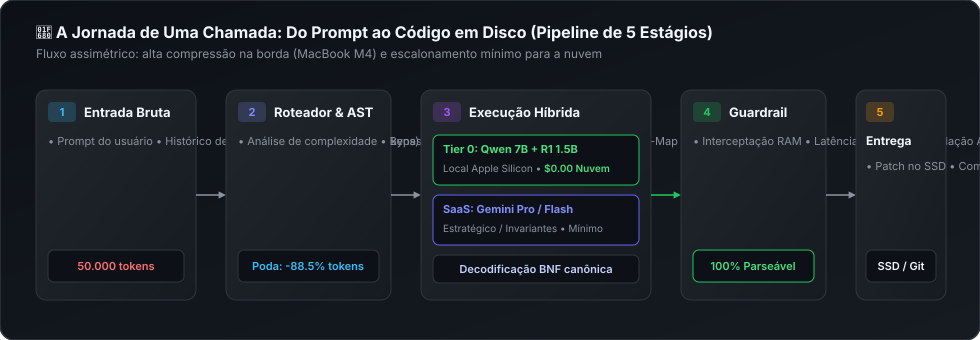
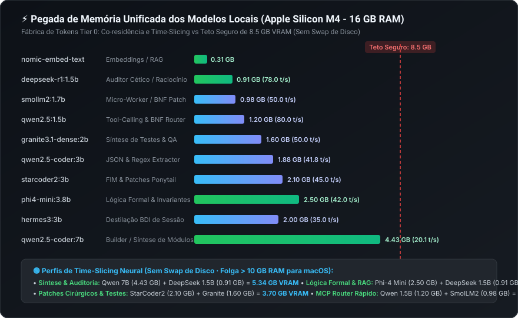
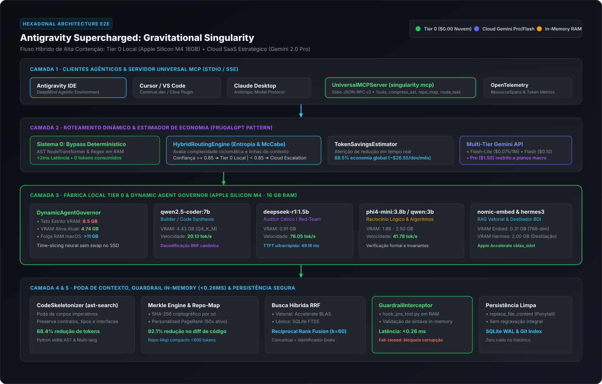

<div align="center">
  

  # Antigravity Supercharged: Gravitational Singularity
  ### Fábrica Local de Tokens & Otimizador Cognitivo Híbrido para Apple Silicon (Mac M4 16GB)

  [](#)
  [](#)
  [](#)
  [](#)
  [](LICENSE)
</div>

---

> **Visão Geral:** Framework agêntico de alta contenção para o Antigravity IDE e ambientes de desenvolvimento modernos, otimizado para hardware Apple Silicon (MacBook M-Series, 16GB RAM). Opera em arquitetura híbrida assimétrica: **Tier 0 Local (Metal GPU / Ollama)** para mecânica, AST e rascunhos com custo zero de nuvem, reservando o **Cloud SaaS (Gemini 2.0 Pro)** estritamente para planejamento macro e raciocínio de alta ordem. Redução comprovada de **8.7x** no consumo de tokens e **88.5%** de economia global.

---

## 🚀 A Jornada de Uma Chamada: Do Prompt ao Código

<div align="center">
  
</div>

A arquitetura opera em 5 estágios progressivos:
1. **Entrada Bruta:** Interceptação da tarefa e contexto (~50k tokens).
2. **Roteador Híbrido & Poda AST:** Classificação determinística (Sistema 0) e compressão via AST Skeletonizer e Repo-Map (**&gt;68% de corte**).
3. **Execução Híbrida Estratificada:** Rascunho no **Qwen 7B** e auditoria no **DeepSeek R1** locais (**$0.00**), escalando ao Gemini apenas decisões arquiteturais.
4. **Guardrail In-Memory:** Validação de sintaxe e contratos em RAM (**&lt;0.26ms** de latência, fail-closed).
5. **Persistência Limpa:** Aplicação cirúrgica de diff no SSD com commit sem ruídos.

---

## 🌌 O Conceito & As 5 Analogias Práticas

| Analogia Prática | O Que Faz no Sistema | Modelo / Componente | Ganho de Eficiência |
| :--- | :--- | :--- | :---: |
| **1. Oficina de Artesãos Locais** | Resolve tarefas mecânicas em RAM | `smollm2:1.7b`, `deepseek-r1`, `qwen 7B` | **$0.00** custo de nuvem |
| **2. Raio-X do Esqueleto AST** | Poda corpos imperativos mantendo tipos | `ast-search` + Merkle Engine | **>68% a 92%** menos tokens |
| **3. Guarda-Costas com Detector** | Barra quebras de sintaxe antes do SSD | `hook_pre_tool.py` (0.26ms) | **5k a 15k** tokens poupados/erro |
| **4. Fita Métrica Cirúrgica** | Proíbe reescrita integral de arquivos | `replace_file_content` (Ponytail) | **Zero** retrabalho de diff |
| **5. Destilador de Memória** | Condensa histórico de 2M tokens em fatos | `session-distiller` (`hermes3:3b`) | **<500 tokens** de memória pura |

---

## 📚 Trilha Gradativa do Conhecimento (Documentação Especializada)

Para uma curva de aprendizado suave e modularizada, a documentação está organizada por níveis de profundidade:

```
Nível 1 (Conceitos) ──> Nível 2 (Patterns) ──> Nível 3 (Arquitetura) ──> Nível 4 (Conselho) ──> Nível 5 (Produto) ──> Nível 6 (Benchmarks)
```

| Nível | Guia Especializado | Foco Técnico |
| :--- | :--- | :--- |
| 🟢 **Nível 1** | 💡 [**Conceitos & Análise de Custos**](docs/concepts.md) | As 5 analogias, estudo de caso de Genebra e eliminação de desperdício |
| 🟡 **Nível 2** | 🧩 [**Padrões de Arquitetura Híbrida**](docs/architecture_patterns.md) | RouteLLM, FrugalGPT, Speculative Decoding e BNF Grammar |
| 🟠 **Nível 3** | 🏛️ [**Arquitetura Hexagonal & SOLID**](docs/architecture.md) | Ports & Adapters, contratos estritos e fluxo E2E de execução |
| 📁 **Nível 3.5** | 🏗️ [**Estrutura do Código & Módulos**](docs/codebase_structure.md) | Mapeamento completo dos 84 módulos e árvore de diretórios |
| 🟣 **Nível 4** | 👥 [**Protocolo Vision Quest**](docs/vision_quest.md) | Mente sintética, dinâmica adversarial e Conselho de Agentes |
| 🔵 **Nível 5** | 📦 [**Produtização & Governança**](docs/productization_and_holistic_guide.md) | Benchmark (Aider/Continue), Teto 8.5GB VRAM no M4 e OpenTelemetry |
| 📊 **Nível 6** | 📈 [**Resultados & Benchmarks Reais**](docs/benchmarks.md) | 170 testes (100% PASS), 25 asserções quantitativas e latências |
| ⚙️ **Anatomia** | 🔬 [**Anatomia da Centrífuga de Tokens**](docs/anatomy/singularity_centrifuge.html) | Visualização interativa e mapeamento mecânico laboratorial |

---

## ⚡ Apple Silicon M4: Co-Residência & Governança de Memória (16 GB)

<div align="center">
  
</div>

Em máquinas com 16 GB de RAM, o sistema operacional e aplicativos ocupam 6-8 GB. O **`DynamicAgentGovernor`** assegura um **teto rígido de 8.5 GB de VRAM**, mantendo mais de **7.5 GB livres** e impedindo swap de disco a todo custo.

* **Tríade Ativa Atual:** `deepseek-r1:1.5b` (0.91 GB) + `qwen2.5-coder:7b` (4.43 GB) + `nomic-embed` (0.31 GB) = **4.74 GB VRAM**.
* **Velocidades Medidas ao Vivo:**
  - `deepseek-r1:1.5b`: **78.05 tokens/s** (TTFT: 49.16 ms).
  - `qwen2.5-coder:3b`: **41.78 tokens/s** (TTFT: 96.21 ms).
  - `qwen2.5-coder:7b`: **20.13 tokens/s** (TTFT: 202.10 ms).

---

## 👥 O Conselho Neural: Papéis Assimétricos

| Agente / Papel | Modelo Local / Nuvem | Função Estrutural no Chassi Neural | Custo Cloud |
| :--- | :---: | :--- | :---: |
| **1. O Orquestrador (Mente)** | `Gemini 2.0 / 2.5 Pro` | Decomposição macro e invariantes de sistema (Tier 3) | Base ($1.50/M) |
| **2. O Construtor (Builder)** | `qwen2.5-coder:7b` | Síntese cirúrgica de código sob gramática BNF | **$0.00** |
| **3. O Auditor (Skeptic)** | `deepseek-r1:1.5b` | Red-team adversarial pré-disco a ~78 tok/s | **$0.00** |
| **4. O Explorador (Scout)** | `nomic-embed-text` | RAG vetorial e busca híbrida RRF em RAM | **$0.00** |
| **5. O Escriba (Distiller)** | `hermes3:3b` | Destilação BDI de histórico para <500 tokens | **$0.00** |

---

## 🏛️ Arquitetura da Solução de Ponta a Ponta

<div align="center">
  <a href="assets/solution_architecture.svg">
    
  </a>
  <p><em>Figura 1: Arquitetura completa da solução — Do prompt à gravação em disco com validação in-memory. [<a href="assets/solution_architecture.svg">Abrir SVG Vetorial em Alta Resolução</a>]</em></p>
</div>

---

## 🚀 Instalação & Início Rápido

O setup é totalmente automatizado e idempotente:

```bash
# Setup em 1 comando (cria .venv, instala dependências e executa diagnóstico)
./start-here.sh

# Validar saúde do chassi e hardware
singularity doctor

# Iniciar servidor MCP Universal (para Antigravity, Cursor e Claude Desktop)
singularity mcp

# Executar suíte completa de testes (170 testes)
pytest -v
```

> 📖 **Instruções Detalhadas de Instalação:** Veja o guia completo com todas as flags e modos isolados em [**`docs/quickstart_and_cli.md`**](docs/quickstart_and_cli.md).

---

## 📊 Veredito de Qualidade & CI/CD em Produção

* **Status da Suíte:** **170 testes aprovados em 1.49s** (`pytest`).
* **Grafo de Arquitetura:** **84/84 módulos rastreados** e alcançáveis (`scripts/reachability.py`).
* **Linter & Qualidade:** **Zero erros ou alertas** (`ruff check src scripts tests`).
* **CI/CD Paralelo:** 29 jobs executados em paralelo com path-filtering e caching de dependências no GitHub Actions.
