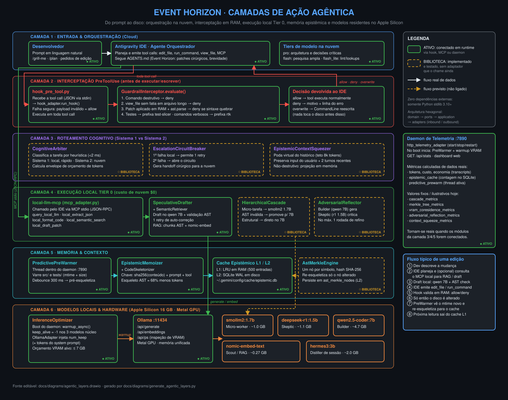
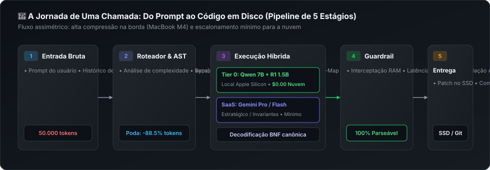

# 🏛️ Arquitetura Hexagonal & Engenharia do Sistema

O núcleo de engenharia do Gravitational Singularity opera estritamente sob **Arquitetura Hexagonal (Ports & Adapters)** com **Zero Dependências Externas** (utilizando exclusivamente a biblioteca padrão do Python 3.10+: `typing.Protocol`, `dataclasses`, `abc`, `ast`, `urllib`, `json`), garantindo inicialização a frio em **<0.26ms** sem overhead de `pip` ou ambientes virtuais pesados.

---

## 1. Topologia Hexagonal (Ports & Adapters)

```
                   ┌────────────────────────────────────────┐
                   │          DRIVING ADAPTERS              │
                   │  • Antigravity PreTool Hook (stdin)   │
                   │  • Local LLM MCP Server (stdio RPC)    │
                   │  • Telemetry Daemon HTTP (:7890)       │
                   └──────────────────┬─────────────────────┘
                                      │ (invoca)
                                      ▼
                   ┌────────────────────────────────────────┐
                   │             INBOUND PORTS              │
                   │  IGuardrail, ICognitiveArbiter         │
                   │  ICircuitBreaker, IEpistemicMemoizer   │
                   │  IContextSqueezer, IPreWarmer          │
                   │  IAdversarialReflector, IAstMerkleEngine│
                   │  IHierarchicalCascade, IInferenceOpt   │
                   └──────────────────┬─────────────────────┘
                                      │
                                      ▼
        ┌──────────────────────────────────────────────────────────────┐
        │                       APPLICATION CORE                       │
        │  GuardrailInterceptor, SpeculativeDrafter, CodeSkeletonizer  │
        │  SemanticRetriever, EpistemicDistiller, TelemetryAggregator  │
        │  CognitiveArbiter, EscalationCircuitBreaker, AstMerkleEngine │
        │  HierarchicalCascade, InferenceOptimizer, PreWarmer          │
        │                                                              │
        │                      DOMAIN ENTITIES                         │
        │   TokenMetric, CostUSD, DiffPatch, SessionState, CodeChunk   │
        │   AstMerkleNode, AstMerkleTree, VramCoResidenceState         │
        └─────────────────────────────┬────────────────────────────────┘
                                      │
                                      ▼
                   ┌────────────────────────────────────────┐
                   │             OUTBOUND PORTS             │
                   │  ILLMClient, IAstParser, IVectorStore  │
                   │  IEpistemicCache, ITranscriptRepository│
                   │  IMetalCompute, IIncrementalAstParser  │
                   │  IFileSystemGateway                    │
                   └──────────────────┬─────────────────────┘
                                      │ (implementado por)
                                      ▼
                   ┌────────────────────────────────────────┐
                   │           DRIVEN ADAPTERS              │
                   │  • OllamaClientAdapter (Metal API)     │
                   │  • MetalComputeAdapter (MSL/Accelerate)│
                   │  • IncrementalAstAdapter (Tree-sitter) │
                   │  • MultiLanguageAstAdapter (ast.parse) │
                   │  • SqliteEpistemicCacheAdapter (L1/L2) │
                   │  • SemanticPromptCache (Cosine L0)     │
                   │  • LocalFileSystemAdapter              │
                   └────────────────────────────────────────┘
```

---

## 2. Aplicação Rigorosa dos Princípios SOLID

1. **Single Responsibility Principle (SRP):**
   * O validador de sintaxe AST (`MultiLanguageAstAdapter`) não possui qualquer acoplamento com o Antigravity ou com protocolos HTTP; ele apenas analisa strings e árvores de sintaxe em memória.
   * O servidor MCP (`McpServer`) apenas serializa/desserializa mensagens JSON-RPC 2.0 e despacha para os casos de uso correspondentes.
   * O agregador de telemetria apenas processa dados brutos de histórico; a conversão metafórica (livros, cafés) é responsabilidade exclusiva dos Value Objects de Domínio.

2. **Open/Closed Principle (OCP):**
   * Novos analisadores de linguagem (ex: Go, Rust, C++) podem ser integrados implementando o contrato `IAstParser` sem necessidade de alterar uma única linha do `GuardrailInterceptor`.
   * Provedores adicionais de inferência podem ser plugados implementando o contrato `ILLMClient`.

3. **Liskov Substitution Principle (LSP):**
   * Fakes e Mocks utilizados nos testes unitários (`FakeAstParser`, `FakeLLMClient`, `FakeFileSystem`) honram rigorosamente as assinaturas abstratas (`Protocol` / `ABC`), permitindo suítes de testes determinísticas executadas em 0.3s sem I/O real.

4. **Interface Segregation Principle (ISP):**
   * Em vez de uma interface monolítica, as portas são finamente segregadas: `IGuardrail` para bloqueio preventivo, `ICognitiveArbiter` para classificação de tarefas, `IEpistemicMemoizer` para cache, `IAstMerkleEngine` para nós Merkle e `IHierarchicalCascade` para cascata tier-0.

5. **Dependency Inversion Principle (DIP):**
   * Os Casos de Uso (`SpeculativeDrafter`, `HierarchicalCascade`, `GuardrailInterceptor`, `InferenceOptimizer`) dependem exclusivamente de abstrações (`ABC` / `Protocol`), recebendo suas dependências concretas via injeção de dependência no construtor (`__init__`).

---

## 3. Fachadas Finas de Retrocompatibilidade (Thin Facades)

Para garantir 100% de estabilidade com ferramentas externas, os pontos de entrada em `scripts/` operam como cascas finas de menos de 15 linhas que importam a arquitetura modular em `src/`, com fallback automático à prova de falhas:
* `scripts/hook_pre_tool.py` ➔ `src.adapters.inbound.hook_adapter`
* `scripts/local_llm_mcp.py` ➔ `src.adapters.inbound.mcp_adapter`
* `scripts/token_tracker_server.py` ➔ `src.adapters.inbound.http_telemetry_adapter`
* `scripts/code_rag.py` ➔ `src.adapters.inbound.cli_adapters.run_code_rag_cli`
* `scripts/session_distiller.py` ➔ `src.adapters.inbound.cli_adapters.run_session_distiller_cli`

---

## 4. Arquitetura em Camadas (Visão Vetorial)

<div align="center">
  <a href="../assets/agentic_layers.svg">
    
  </a>
  <p><em>Figura 1: As 6 Camadas de Ação Agêntica — Da orquestração em nuvem à interceptação em RAM, execução local Tier 0 e memória no Apple Silicon. [<a href="../assets/agentic_layers.svg">Abrir SVG Vetorial em Alta Resolução</a>]</em></p>
</div>

---

## 4. Dissecação das 6 Camadas de Ação Agêntica

| Camada | Escopo | Componente Principal | Status | Papel no Pipeline |
| :--- | :--- | :--- | :---: | :--- |
| **Camada 1** | Entrada & Orquestração | Gemini Pro / Flash | `● ATIVO` | Planejamento macro, emissão de tool calls e fixação de invariantes |
| **Camada 2** | Interceptação PreTool | `hook_pre_tool.py` / `GuardrailInterceptor` | `● ATIVO` | Validação in-memory AST (<0.26ms), IPC Shared Memory (<5µs), bloqueio destrutivo e reescrita de testes |
| **Camada 3** | Roteamento Cognitivo | `CognitiveArbiter` / `CircuitBreaker` | `● ATIVO` | Classificação Sistema 1 vs 2 (McCabe > 10), Context Masking de turnos passados e teto de 8k tokens |
| **Camada 4** | Execução Local Tier 0 | `UnifiedExecutionPipeline` / `local-llm-mcp` | `● ATIVO` | Drafter 7B + Skeptic 1.5B com Grammar-Constrained Decoding (BNF/Schema) e zero custo de nuvem |
| **Camada 5** | Memória & Cache Epistêmico| L1 RAM + L2 SQLite WAL + L3 Git Index | `● ATIVO` | Poda simbólica diferencial (>96%), Merkle Tree e persistência entre sessões/branches por commit Git |
| **Camada 6** | Hardware & Apple Silicon | Ollama Metal GPU (<7.0 GB VRAM) | `● ATIVO` | Co-residência tripla (`keep_alive: -1`), `lock_models_in_vram()` e KV-cache zero-prefill (`num_keep`) |

### Detalhamento Operacional:

**Camada 1 — Entrada & Orquestração (Nuvem):** O desenvolvedor envia a instrução; o agente orquestrador do Antigravity planeja e emite tool calls (`edit_file`, `run_command`, `view_file` ou chamadas MCP). Toda a decisão de negócio de alto nível nasce aqui.

**Camada 2 — Interceptação `PreToolUse` (Ativa):** Antes de tocar no SSD, o `hook_pre_tool.py` delega a validação ao `GuardrailInterceptor`:
1. Comandos destrutivos são barrados (`deny`).
2. Chamadas de edição (`edit_file`, `write_file`, `replace_file_content`, `write_to_file`) passam pelo simulador in-memory AST (<0.26ms), barrando quebras de sintaxe antes de qualquer gravação no SSD.
3. Testes recebem o prefixo `test-slicer` e comandos verbosos recebem `rtk`.
4. Comunicação ultra-rápida via buffer circular em RAM (`multiprocessing.shared_memory`), trocando telemetria inter-processos em **<5 microssegundos**.

**Camada 3 — Roteamento Cognitivo (Ativa):**
- `CognitiveArbiter`: Avalia intenção, palavras-chave e complexidade ciclomática de McCabe. Se `McCabe > 10` ou multi-módulo, escala para Sistema 2 (Nuvem).
- `EscalationCircuitBreaker`: Trava contra loops de repetição após 2 falhas consecutivas, gerando handoff sintetizado.
- `EpistemicContextSqueezer`: Mascara diffs aplicados em turnos anteriores e projeta virtualmente histórico sob teto de 8k tokens.

**Camada 4 — Execução Local Tier 0 (Ativa):**
- O servidor MCP `local-llm-mcp` expõe ferramentas locais aceleradas por Metal GPU. O `local_draft_patch` roda através do `UnifiedExecutionPipeline`:
  $$\text{Tool Call} \longrightarrow \text{Arbiter} \longrightarrow \text{Drafter (7B)} \longrightarrow \text{Skeptic (1.5B)} \longrightarrow \text{Merkle AST} \longrightarrow \text{Disco}$$
- Grammar-Constrained Decoding: Suporte nativo a esquemas JSON e gramáticas formais BNF direto na amostragem no Metal GPU, impedindo alucinações de prosa indesejada ou JSON malformado.

**Camada 5 — Memória & Cache Epistêmico (Ativa):**
- O `AstMerkleEngine` provê esqueletização diferencial e **Dicionário Simbólico de Diffs** (`generate_symbolic_patch` / `apply_symbolic_patch`), reduzindo o payload de edição para mais de **96%**.
- O `SmartErrorSlicer` isola a asserção violada e o frame de chamada em tracebacks verbosos (<80 tokens).
- O `SqliteEpistemicCacheAdapter` provê 3 níveis: L1 RAM (<0.05ms), L2 SQLite WAL e **L3 Git Commit index**, recarregando o grafo AST intacto após alternar branches a custo zero.

**Camada 6 — Hardware & Apple Silicon (Ativa):**
- A trindade local (`smollm2:1.7b`, `deepseek-r1:1.5b`, `qwen2.5-coder:7b` e `nomic-embed-text`) é travada em VRAM com `lock_models_in_vram()` (`keep_alive: -1`) e `options["num_keep"]` para KV-cache zero-prefill, impedindo que o macOS comprima páginas inativas durante intervalos do desenvolvedor.
- Telemetria reativa via Server-Sent Events (SSE em `GET /api/events`) transmitida em tempo real diretamente da memória compartilhada.

---

## 5. A Jornada de Uma Chamada: Pipeline E2E dos 5 Nós

<div align="center">
  <a href="../assets/call_journey_pipeline.svg">
    
  </a>
  <p><em>Figura 2: Pipeline Visual E2E — Fluxo assimétrico com contenção na borda e gravação validada em disco. [<a href="../assets/call_journey_pipeline.svg">Abrir SVG Vetorial em Alta Resolução</a>]</em></p>
</div>

1. **1. Entrada Bruta:** A requisição chega com histórico e contexto do repositório (~50k tokens brutos).
2. **2. Roteador Gravitacional:** O `cognitive-meta-router` analisa a complexidade e decide a rota de menor custo.
3. **3. Poda AST & Scout RAG:** O `ast-search` elimina até 85% das funções imperativas e o `code-rag` puxa apenas os blocos relevantes via embeddings locais.
4. **4. Execução Estratificada:**
   - Patches pontuais são delegados à cascata Tier-0 local (`smollm2:1.7b` ou `qwen2.5-coder:7b`) via `local_draft_patch` (**Custo = $0.00**).
   - Subagentes exploratórios de pesquisa concorrente rodam em **Gemini Flash / Flash-Lite** (**Economia de até 95%**).
   - O orquestrador central reserva o **Gemini Pro** exclusivamente para decisões estruturais.
5. **5. Guardrail In-Memory & Git:** O `hook_pre_tool.py` compila o patch em 0.26ms na memória RAM. Se for válido, aplica diff cirúrgico; o `rtk` suprime ruídos de terminal e grava a entrega limpa no Git.

---

## 6. Diagramas Vetoriais Editáveis no Draw.io

O projeto disponibiliza diagramas vetoriais nativos editáveis em [app.diagrams.net](https://app.diagrams.net) ou na extensão Draw.io do VS Code:
- [`architecture.drawio`](../architecture.drawio): Diagrama de 5 camadas da arquitetura geral com estilo GitHub Dark.
- [`docs/diagrams/agentic_layers.drawio`](diagrams/agentic_layers.drawio): Diagrama completo de ação agêntica das 6 camadas com status ATIVO / BIBLIOTECA, gerado sincronizadamente via [`generate_agentic_layers.py`](diagrams/generate_agentic_layers.py).
