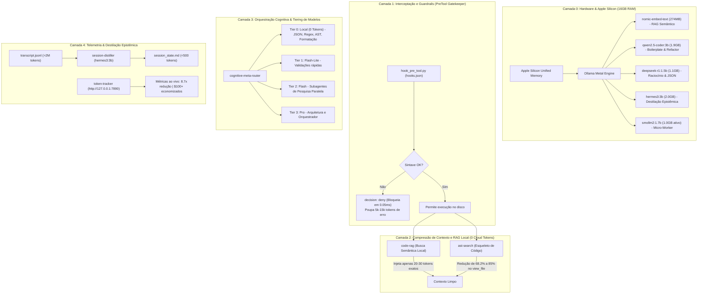
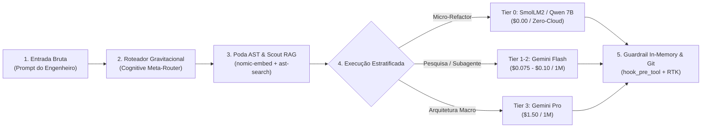

# 🏛️ Arquitetura Hexagonal & Engenharia do Sistema

O núcleo de engenharia do Gravitational Singularity opera estritamente sob **Arquitetura Hexagonal (Ports & Adapters)** com **Zero Dependências Externas** (utilizando exclusivamente a biblioteca padrão do Python 3.10+: `typing.Protocol`, `dataclasses`, `abc`, `ast`, `urllib`, `json`), garantindo inicialização a frio em **<0.26ms** sem overhead de `pip` ou ambientes virtuais pesados.

---

## 1. Topologia Hexagonal (Ports & Adapters)

```
                   ┌────────────────────────────────────────┐
                   │          DRIVING ADAPTERS              │
                   │  • Antigravity PreTool Hook (stdin)   │
                   │  • Local LLM MCP Server (stdio RPC)    │
                   │  • Telemetry Daemon HTTP (:7890)       │
                   └──────────────────┬─────────────────────┘
                                      │ (invoca)
                                      ▼
                   ┌────────────────────────────────────────┐
                   │             INBOUND PORTS              │
                   │  IGuardrail, ICognitiveArbiter         │
                   │  ICircuitBreaker, IEpistemicMemoizer   │
                   │  IContextSqueezer, IPreWarmer          │
                   │  IAdversarialReflector, IAstMerkleEngine│
                   │  IHierarchicalCascade, IInferenceOpt   │
                   └──────────────────┬─────────────────────┘
                                      │
                                      ▼
        ┌──────────────────────────────────────────────────────────────┐
        │                       APPLICATION CORE                       │
        │  GuardrailInterceptor, SpeculativeDrafter, CodeSkeletonizer  │
        │  SemanticRetriever, EpistemicDistiller, TelemetryAggregator  │
        │  CognitiveArbiter, EscalationCircuitBreaker, AstMerkleEngine │
        │  HierarchicalCascade, InferenceOptimizer, PreWarmer          │
        │                                                              │
        │                      DOMAIN ENTITIES                         │
        │   TokenMetric, CostUSD, DiffPatch, SessionState, CodeChunk   │
        │   AstMerkleNode, AstMerkleTree, VramCoResidenceState         │
        └─────────────────────────────┬────────────────────────────────┘
                                      │
                                      ▼
                   ┌────────────────────────────────────────┐
                   │             OUTBOUND PORTS             │
                   │  ILLMClient, IAstParser, IVectorStore  │
                   │  IEpistemicCache, ITranscriptRepository│
                   │  IFileSystemGateway                    │
                   └──────────────────┬─────────────────────┘
                                      │ (implementado por)
                                      ▼
                   ┌────────────────────────────────────────┐
                   │           DRIVEN ADAPTERS              │
                   │  • OllamaClientAdapter (Metal API)     │
                   │  • MultiLanguageAstAdapter (ast.parse) │
                   │  • SqliteEpistemicCacheAdapter (L1/L2) │
                   │  • FileTranscriptRepository            │
                   │  • LocalFileSystemAdapter              │
                   └────────────────────────────────────────┘
```

---

## 2. Aplicação Rigorosa dos Princípios SOLID

1. **Single Responsibility Principle (SRP):**
   * O validador de sintaxe AST (`MultiLanguageAstAdapter`) não possui qualquer acoplamento com o Antigravity ou com protocolos HTTP; ele apenas analisa strings e árvores de sintaxe em memória.
   * O servidor MCP (`McpServer`) apenas serializa/desserializa mensagens JSON-RPC 2.0 e despacha para os casos de uso correspondentes.
   * O agregador de telemetria apenas processa dados brutos de histórico; a conversão metafórica (livros, cafés) é responsabilidade exclusiva dos Value Objects de Domínio.

2. **Open/Closed Principle (OCP):**
   * Novos analisadores de linguagem (ex: Go, Rust, C++) podem ser integrados implementando o contrato `IAstParser` sem necessidade de alterar uma única linha do `GuardrailInterceptor`.
   * Provedores adicionais de inferência podem ser plugados implementando o contrato `ILLMClient`.

3. **Liskov Substitution Principle (LSP):**
   * Fakes e Mocks utilizados nos testes unitários (`FakeAstParser`, `FakeLLMClient`, `FakeFileSystem`) honram rigorosamente as assinaturas abstratas (`Protocol` / `ABC`), permitindo suítes de testes determinísticas executadas em 0.3s sem I/O real.

4. **Interface Segregation Principle (ISP):**
   * Em vez de uma interface monolítica, as portas são finamente segregadas: `IGuardrail` para bloqueio preventivo, `ICognitiveArbiter` para classificação de tarefas, `IEpistemicMemoizer` para cache, `IAstMerkleEngine` para nós Merkle e `IHierarchicalCascade` para cascata tier-0.

5. **Dependency Inversion Principle (DIP):**
   * Os Casos de Uso (`SpeculativeDrafter`, `HierarchicalCascade`, `GuardrailInterceptor`, `InferenceOptimizer`) dependem exclusivamente de abstrações (`ABC` / `Protocol`), recebendo suas dependências concretas via injeção de dependência no construtor (`__init__`).

---

## 3. Fachadas Finas de Retrocompatibilidade (Thin Facades)

Para garantir 100% de estabilidade com ferramentas externas, os pontos de entrada em `scripts/` operam como cascas finas de menos de 15 linhas que importam a arquitetura modular em `src/`, com fallback automático à prova de falhas:
* `scripts/hook_pre_tool.py` ➔ `src.adapters.inbound.hook_adapter`
* `scripts/local_llm_mcp.py` ➔ `src.adapters.inbound.mcp_adapter`
* `scripts/token_tracker_server.py` ➔ `src.adapters.inbound.http_telemetry_adapter`
* `scripts/code_rag.py` ➔ `src.adapters.inbound.cli_adapters.run_code_rag_cli`
* `scripts/session_distiller.py` ➔ `src.adapters.inbound.cli_adapters.run_session_distiller_cli`

---

## 4. Arquitetura em Camadas (Mermaid)



---

## 5. A Jornada de Uma Chamada: Pipeline E2E dos 5 Nós



1. **1. Entrada Bruta:** A requisição chega com histórico e contexto do repositório (~50k tokens brutos).
2. **2. Roteador Gravitacional:** O `cognitive-meta-router` analisa a complexidade e decide a rota de menor custo.
3. **3. Poda AST & Scout RAG:** O `ast-search` elimina até 85% das funções imperativas e o `code-rag` puxa apenas os blocos relevantes via embeddings locais.
4. **4. Execução Estratificada:**
   - Patches pontuais são delegados à cascata Tier-0 local (`smollm2:1.7b` ou `qwen2.5-coder:7b`) via `local_draft_patch` (**Custo = $0.00**).
   - Subagentes exploratórios de pesquisa concorrente rodam em **Gemini Flash / Flash-Lite** (**Economia de até 95%**).
   - O orquestrador central reserva o **Gemini Pro** exclusivamente para decisões estruturais.
5. **5. Guardrail In-Memory & Git:** O `hook_pre_tool.py` compila o patch em 0.26ms na memória RAM. Se for válido, aplica diff cirúrgico; o `rtk` suprime ruídos de terminal e grava a entrega limpa no Git.

---

## 6. Diagramas Vetoriais Editáveis no Draw.io

O projeto disponibiliza diagramas vetoriais nativos editáveis em [app.diagrams.net](https://app.diagrams.net) ou na extensão Draw.io do VS Code:
- [`architecture.drawio`](../architecture.drawio): Diagrama de 5 camadas da arquitetura geral com estilo GitHub Dark.
- [`docs/diagrams/agentic_layers.drawio`](diagrams/agentic_layers.drawio): Diagrama completo de ação agêntica das 6 camadas com status ATIVO / BIBLIOTECA, gerado sincronizadamente via [`generate_agentic_layers.py`](diagrams/generate_agentic_layers.py).
