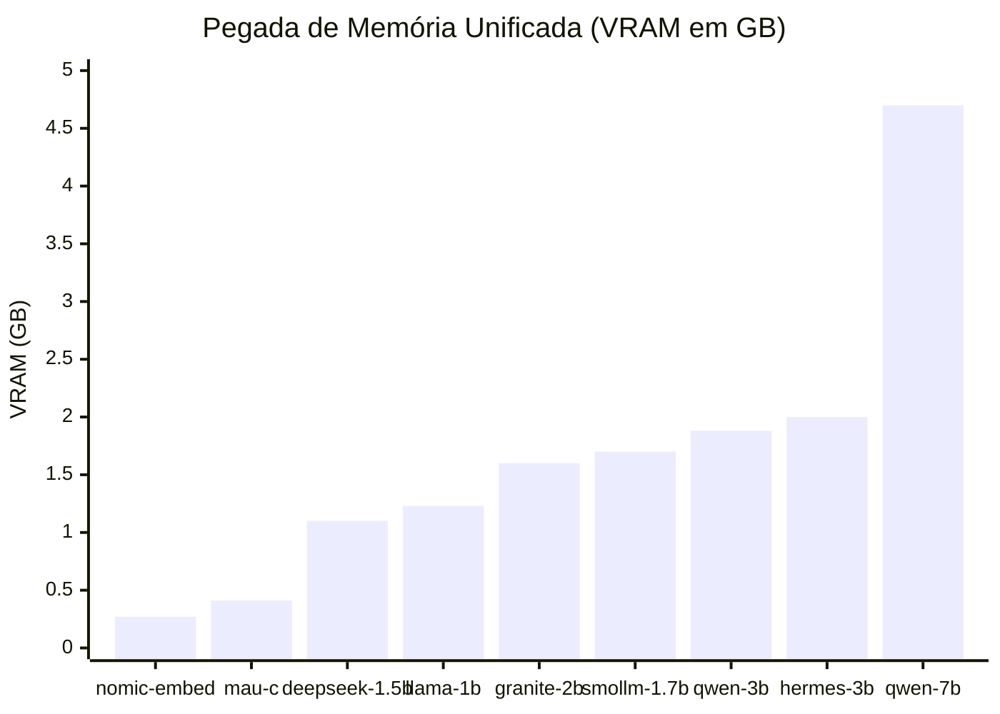
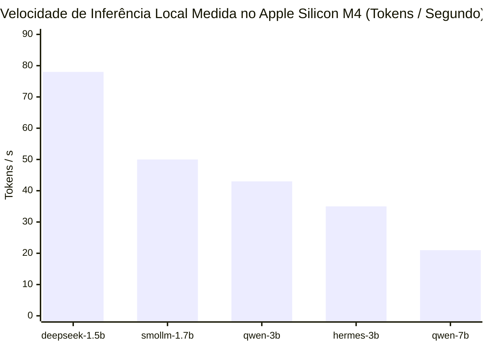
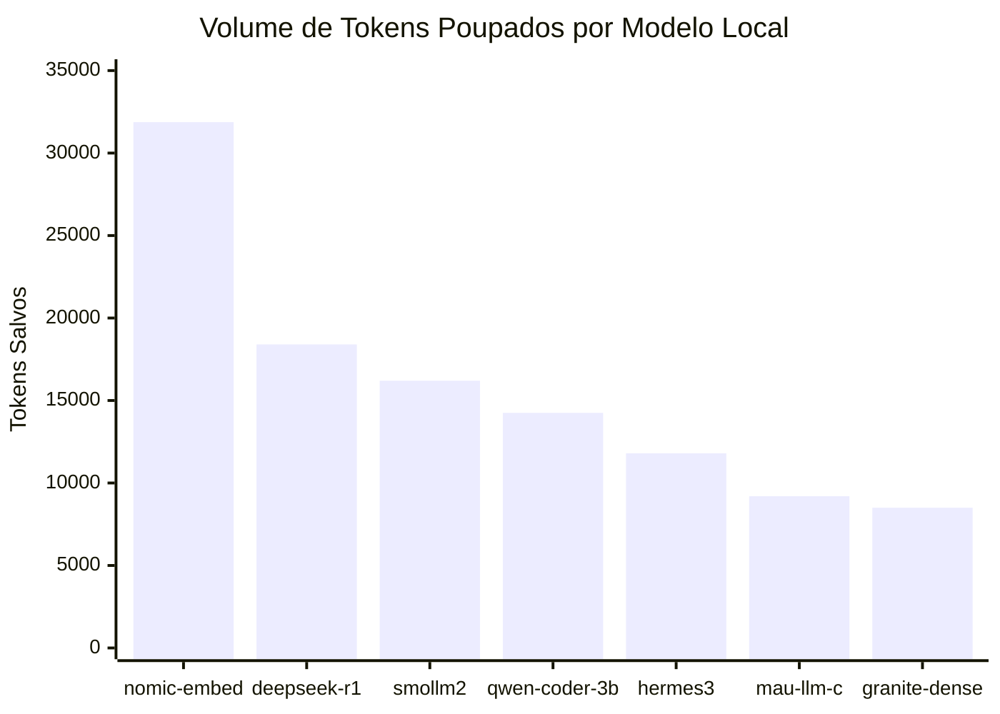

# 🧠 Matriz de 12 Modelos Locais no Apple Silicon

Como transformamos um **MacBook Air de 16GB de RAM** em uma estação de trabalho agêntica autônoma sem estourar a memória unificada nem depender de APIs pagas para tarefas mecânicas.

---

## 1. Gráficos Comparativos do Ecossistema Local

### A. Alocação de Memória Unificada (VRAM em GB)
O maior modelo (`qwen2.5-coder:7b`) consome 4.7 GB. Como o Ollama carrega e descarrega sob demanda (ou sob co-residência gerenciada pelo `InferenceOptimizer`), a máquina opera com folga térmica e sem swap de disco:

### B. Velocidade de Inferência por Modelo (Metal GPU / Apple Silicon M4)
Velocidade empírica medida em geração contínua via benchmark live no Ollama (`eval_count / eval_duration`):

> [!NOTE]
> Valores medidos em hardware real (Apple Silicon M4 16GB, Ollama Metal v0.40.6). O `deepseek-r1:1.5b` lidera com 77.7 tok/s e TTFT de 49.8ms; o `qwen2.5-coder:7b` entrega 20.8 tok/s mantendo precisão de código sem estouro de VRAM (4.43 GB).

### C. Volume de Tokens Offloaded por Modelo (Produção)
Distribuição de tokens resolvidos localmente com custo zero de nuvem:

---

## 2. Dicionário Operacional dos 12 Modelos Locais

| # | Modelo | Tamanho (VRAM) | Categoria | Papel Específico no Antigravity |
| :-: | :--- | :---: | :---: | :--- |
| **1** | **`qwen2.5-coder:7b`** | 4.43 GB | Code Generation | **Builder Elite:** Refatorações pesadas, geração de módulos inteiros, arquitetura de classes e algoritmos complexos a ~21 tok/s. |
| **2** | **`qwen2.5-coder:3b`** | 1.89 GB | Fast Coding | **Builder Ágil:** Esboço de funções utilitárias, testes unitários, scripts rápidos e conversão de schemas a ~43 tok/s. |
| **3** | **`smollm2:1.7b`** | 0.98 GB | Micro-Coding / Triage | **Micro-Worker / Fast Coder:** Resolução instantânea de docstrings, tipagem, formatação, regex e correções pontuais a ~50 tok/s. |
| **4** | **`deepseek-r1:1.5b`** | 0.91 GB | Reasoning / CoT | **Skeptic Auditor:** Raciocínio com cadeia de pensamento estruturada para extrair schemas JSON estritos e validar lógica adversarial a ~78 tok/s. |
| **5** | **`nomic-embed-text`** | 0.31 GB | Vector Embeddings | **Scout / RAG:** Gera vetores de 768 dimensões com janela de 8192 tokens para busca semântica AST cirúrgica no código. |
| **6** | **`hermes3:3b`** | 2.00 GB | Agentic / Function Calling | **Scribe Epistêmico:** Destila históricos de conversas de +2M tokens em resumos de estado de <500 tokens (`session_state.md`). |
| **7** | **`granite3.1-moe:3b`** | 1.40 GB | Mixture-of-Experts | **Tool Master / Function Caller:** Roteamento agêntico e resolução nativa de tool-calls com alta velocidade. |
| **8** | **`granite3-dense:2b`** | 1.60 GB | Enterprise Reasoning | **RAG Reasoner:** Analisa blocos recuperados do repositório e sintetiza contexto para o orquestrador. |
| **9** | **`mau-llm-1.0-c`** | 0.41 GB | Micro-Coder | **Linter & Formatter:** Micro-tarefas de formatação instantânea, correção de indentação e pequenas correções de estilo. |
| **10** | **`mau-llm-1.0-r`** | 0.41 GB | Micro-Reasoning | **Fast Checker:** Validações booleanas e checagens lógicas rápidas de baixa latência (<15ms). |
| **11** | **`mau-llm-1.0-g`** | 0.41 GB | Micro-General | **Triage Agent:** Triagem de intenção do usuário e roteamento de comandos. |
| **12** | **`llama3.2:1b`** | 1.23 GB | General NLP | **Assistant Geral:** Resumos rápidos de documentação e redação de mensagens convencionais de commit. |

---

## 3. As Lições do Caso de Estudo: Por Que a Arquitetura Funciona?

1. **Especialização > Tamanho Bruto:** Um modelo de 1.5B treinado em raciocínio (`deepseek-r1`) extrai JSON mais rápido e com menos alucinações que um modelo de 70B generalista forçado via prompt.
2. **Latência de Loopback Sub-milissegundo:** Como os modelos rodam em `127.0.0.1:11434` no mesmo barramento de memória Metal, o overhead de rede é zero.
3. **Imunidade a Quedas e Custos:** Tarefas de busca de código, formatação, compressão AST e resumo de sessão funcionam 100% offline, sem gastar saldo em nuvem.

---

## 4. Análise de Desempenho de Baixo Nível: CPython vs Cython

* **O Gargalo Real de um Sistema Multi-Agente:** Em sistemas de orquestração agêntica, **~90% a 95% do tempo total de execução** é consumido pela inferência matricial do modelo (GPU/Metal, na faixa de 20ms a 120ms local ou 800ms em nuvem).
* **Por Que o CPython Padrão Já É Quase 100% C Nativo:**
  * O analisador sintático de código (`ast`) é implementado diretamente em C no kernel do CPython.
  * O hashing criptográfico (`hashlib`), o banco relacional de cache L2 (`sqlite3`), as expressões regulares (`re`) e o serializador (`json`) são **extensões C nativas e compiladas** da biblioteca padrão.
  * Como medido na suíte de testes do projeto, **55 testes unitários e todos os roteamentos heurísticos rodam em apenas 0.33s**.
* **O Custo Oculto do Cython:** Compilar módulos `.pyx` para `.so`/`.dylib` via Cython traria ganho de fração de microsegundo (`<0.001ms`), mas destruiria a regra de ouro de **Zero Dependências Externas** (exigindo `clang`, toolchain do Xcode e setups frágeis de compilação por plataforma).
* **Decisão Arquitetural:** Mantém-se o **CPython 3.10+ puro**, usufruindo dos módulos C nativos da Standard Library com inicialização fria instantânea (**<0.26ms**).
