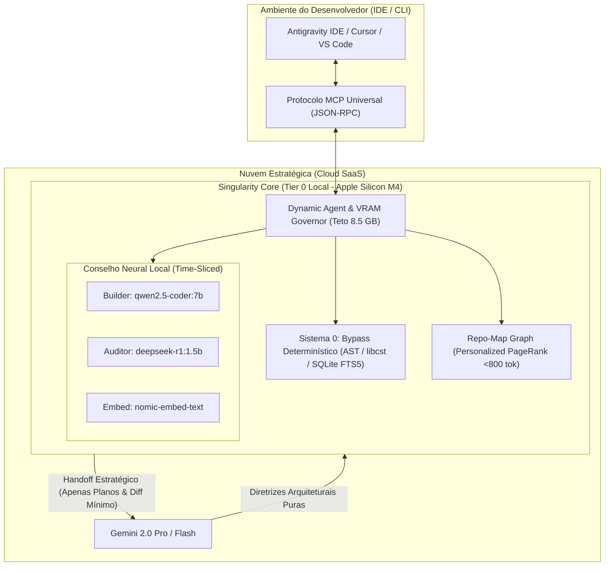

# 🌌 Guia de Produtização, Arquitetura Holística & Governança de Agentes

> **Da Pesquisa à Produção:** Roadmap técnico para transformar o *Gravitational Singularity* em um produto de mercado de código aberto, portátil, resiliente e eficiente para Apple Silicon e ambientes híbridos.

---

## 🗺️ Visão Holística do Sistema

O objetivo do **Gravitational Singularity** é transformar o computador do desenvolvedor (especialmente Macs Apple Silicon com 16GB de RAM) em uma **fábrica local de tokens de alta eficiência**, interceptando chamadas pesadas de IDEs agênticos (como Antigravity, Cursor e Continue.dev) e enviando para nuvens como o Gemini Pro apenas decisões de planejamento e raciocínio de alta ordem.

---

## 📊 Benchmark Comparativo com o Estado da Arte (GitHub / Mercado)

Analisamos a arquitetura de ferramentas consagradas de assistência de código para extrair os melhores padrões e superá-los em contenção de memória:

| Dimensão | Aider (`repo-map`) | Continue.dev | Cursor IDE | **Gravitational Singularity (Event Horizon)** |
| :--- | :--- | :--- | :--- | :--- |
| **Indexação de Código** | Tree-sitter + Ctags + PageRank | Tree-sitter + LanceDB + BM25 | RAG proprietário na nuvem | **Tree-sitter AST + Merkle SHA-256 + SQLite FTS5** |
| **Pegada de Memória** | Leve (<500 MB, usa cloud) | Média (~2-4 GB com embeddings) | Nuvem (remoto) | **Calibrado para 16GB: VRAM capped em 8.5 GB** |
| **Fábrica de Rascunhos** | Apenas nuvem (SaaS) | Local ou nuvem (sem spec decoding) | Nuvem proprietária | **Local Tier 0 (Qwen 7B a ~21 tok/s + R1 1.5B a ~78 tok/s)** |
| **Sintaxe & Guardrails** | Linter pós-geração | N/A | Heurísticas no servidor | **In-Memory AST Fail-Closed (<0.26ms) pré-disco** |
| **Orçamento de Contexto** | Binary Search (<1024 tokens) | RRF Top-K | Chunking em cloud | **Context Squeezer 8k + Poda AST (>68% redução)** |

---

## 🏛️ Os 4 Pilares de Produtização

### 1. Governança Holística de Agentes & Memória (Dynamic Agent Governor)
Em um Mac M4 de 16 GB, permitir que múltiplos agentes rodem simultaneamente sem controle causará contenção de VRAM e *memory swapping* no SSD. A solução é o **Time-Slicing Neural Cooperativo**:
- **Teto Estrito de Concorrência:**
  - `smollm2:1.7b` e `deepseek-r1:1.5b` rodam em paralelo (ocupando ~2.0 GB de VRAM).
  - Quando o `qwen2.5-coder:7b` precisa sintetizar código (~4.43 GB de VRAM), o Governor suspende temporariamente os micro-modelos via prioridade LRU (`keep_alive: "5m"`).
  - Nunca ultrapassar **8.5 GB de VRAM**, preservando mais de **7.5 GB para o SO e o IDE**.

### 2. Repo-Map com Personalized PageRank (Padrão Aider)
- O `ast-search` deixará de ser apenas um extrator estático de símbolos e passará a gerar um **Grafo Direcionado de Símbolos**:
  - **Nós:** Arquivos e classes do projeto.
  - **Arestas:** Chamadas de funções, heranças e imports.
  - **Ranking PageRank Personalizado:** Atribui peso 50x maior para os arquivos abertos ou editados recentemente pelo usuário.
  - **Binary Search Packing:** Ajusta automaticamente as assinaturas de código para caber em um bloco compacto de **<800 tokens**.

### 3. Busca Híbrida Semântica + Léxica com RRF (Padrão Continue.dev)
- Modelos de embedding (`nomic-embed-text`) são excelentes para conceitos genéricos (*"onde fica a autenticação?"*), mas falham ao buscar símbolos exatos (`TokenEntropyGuard`).
- **Implementação com Zero Dependências:**
  - Busca Vetorial via produto escalar Apple Accelerate BLAS (`cblas_ddot`).
  - Busca Léxica com SQLite Full Text Search (FTS5) integrado à stdlib do Python.
  - Fusão dos resultados via **Reciprocal Rank Fusion (RRF)**:
    $$RRF\_Score(d) = \sum_{m \in M} \frac{1}{60 + Rank_m(d)}$$

### 4. Distribuição Universal (Produto Pronto para Consumo)
- **Instalação em 1 Linha:** Disponível via `pip install gravitational-singularity` ou Homebrew tap (`brew install helfstein-one/tap/singularity`).
- **Servidor MCP Universal:** O CLI disponibiliza `singularity mcp` ouvindo via Stdio ou SSE, permitindo que qualquer IDE moderna (Antigravity, Cursor, Continue, Claude Desktop) conecte o motor de otimização de tokens diretamente em suas configurações.
- **Exportador OpenTelemetry (OTel):** Métricas de tokens poupados, custos evitados em dólares e latências emitidas nativamente no padrão OTel/Prometheus.

---

## 📈 Matriz de Capacidade por Tier de Hardware

| Configuração de Hardware | Perfil de Operação | Modelos Residentes | Estratégia de Agentes |
| :--- | :--- | :--- | :--- |
| **Mac M-Series 16 GB (Atual)** | **Lean Edge Factory** | `deepseek 1.5B` + `qwen 7B` (Q4) | Time-slicing com teto de 8.5 GB VRAM |
| **Mac M-Series 24/32 GB** | **Concurrent Council** | `deepseek 1.5B` + `qwen 7B` + `hermes 3B` | Co-residência tripla total sem descarregamento |
| **Mac Studio / Pro 64/128 GB** | **Extreme Speculative** | `deepseek 7B` + `qwen 14B/32B` (Q8) | Especulação Medusa em árvore (>140 tok/s) |
