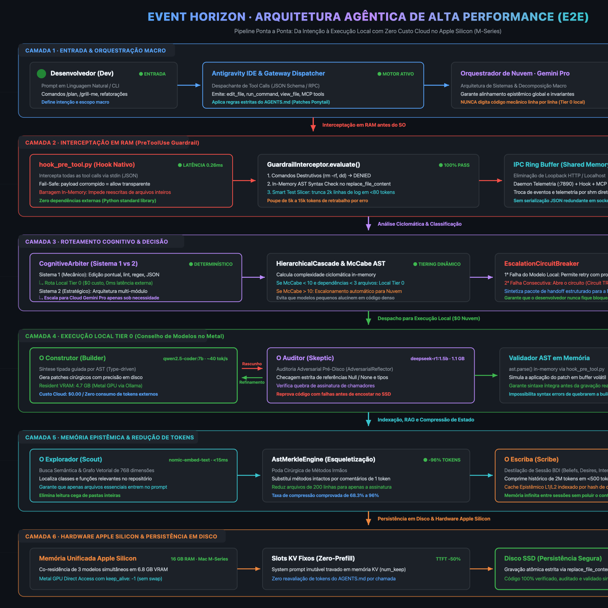
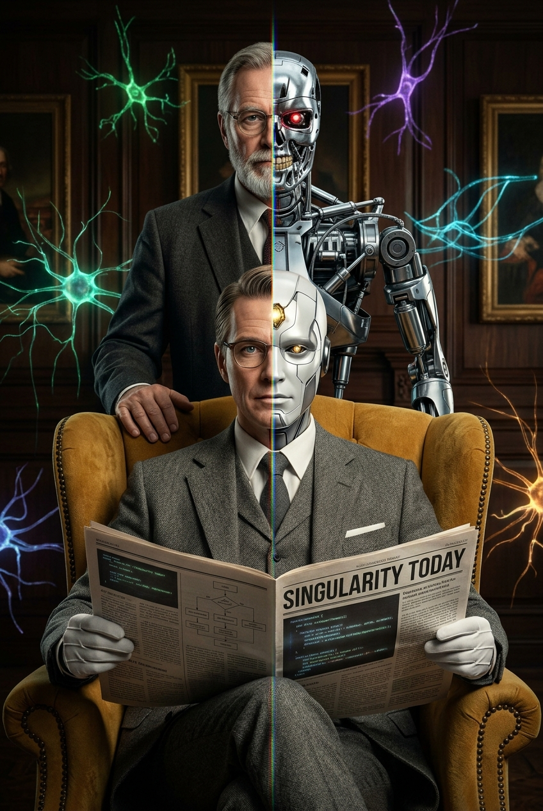
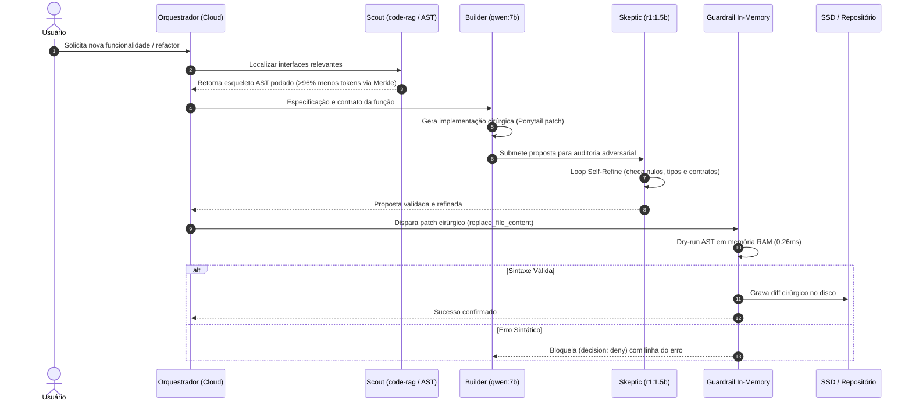

# 👥 O Conselho de Agentes: A Mente Sintética do Visão (*Vision Quest Protocol*)

<div align="center">
  <a href="../assets/solution_architecture.svg">
    
  </a>
  <p><em>Figura 1: Arquitetura da Solução e Fluxo E2E — Da emissão da tool call à interceptação em RAM (&lt;0.26ms), roteamento cognitivo, execução local Tier 0 ($0 nuvem), compressão AST/Merkle e gravação segura no SSD. [<a href="../assets/solution_architecture.svg">Abrir SVG Vetorial</a>]</em></p>
</div>

<div align="center">
  
  <p><em>Figura 2: O Retrato Split 50/50 — O contraste vertical entre humanidade e síncrese cibernética no Visão e no Ultron, unificados por scanlines CRT e nós sinápticos do conselho deliberativo.</em></p>
</div>

---

## 1. Fundamentação Teórica & Narrativa

Na clássica saga *Vision Quest* e na estrutura neural do sintozóide **Visão** (Marvel), sua inteligência superior nunca derivou de um processo linear único, mas sim de uma **matriz de sub-processadores cognitivos assimétricos operando em simbiose dentro de um mesmo chassi de vibrânio**:

1. **A Joia da Mente / Consciência Nexus:** Atua como o nexo de sincronismo, vontade e propósito executivo, estabelecendo intenções e invariantes de sistema sem se perder na digitação mecânica de baixo nível.
2. **Sub-Agentes Especializados:** Realizam cálculos imperativos, testes de coerência lógica, auditorias de segurança e indexação de memória.
3. **A Dicotomia Criador vs. Criação (Ultron / Simon Williams / Visão):** Assim como o Visão precisa confrontar o código-fonte de seus criadores para transcender o viés de destruição e atingir a síntese pura, nosso sistema confronta e audita todo rascunho de código antes que ele atinja o mundo físico (o SSD do desenvolvedor).

Neste projeto, em vez de delegar todo o trabalho para um único modelo generalista e inflado, o sistema opera exatamente como a **mente sintética do Visão**: uma banca deliberativa de 5 papéis neurais assimétricos.

---

## 2. Os 5 Integrantes da Mesa Deliberativa

```
                 ┌──────────────────────────────────────┐
                 │       O ORQUESTRADOR / ARQUITETO     │
                 │   (Tier 3: Gemini Pro / Flash Nuvem) │
                 │      • Design by Contract & Macro    │
                 └──────────────────┬───────────────────┘
                                    │
         ┌──────────────────────────┼──────────────────────────┐
         ▼                          ▼                          ▼
┌──────────────────┐       ┌──────────────────┐       ┌──────────────────┐
│  O CONSTRUTOR    │       │    O AUDITOR     │       │   O EXPLORADOR   │
│     (BUILDER)    │       │     (SKEPTIC)    │       │     (SCOUT)      │
│ qwen2.5-coder:7b │◄─────►│ deepseek-r1:1.5b │       │ nomic-embed-text │
│ • Type-Driven    │       │ • Red-Teaming    │       │ • Hiperespaço RAG│
│   Synthesis      │       │   Adversarial    │       │   e Poda AST     │
└──────────────────┘       └──────────────────┘       └──────────────────┘
         │                          │                          │
         └──────────────────────────┼──────────────────────────┘
                                    ▼
                 ┌──────────────────────────────────────┐
                 │         O ESCRIBA / DISTILLER        │
                 │          (Tier 0: hermes3:3b)        │
                 │    • Compressão Epistêmica e BDI     │
                 └──────────────────────────────────────┘
```

### 1. O Orquestrador / Arquiteto (Tier 3 - Gemini Pro/Flash na Nuvem)
* **Aura Branca/Dourada:** Recebe a intenção de alto nível do desenvolvedor, decompõe o problema em sub-metas e estabelece invariantes de sistema. Nunca gasta tokens digitando código repetitivo ou corrigindo vírgulas.

### 2. O Construtor / Builder (Tier 0 - `qwen2.5-coder:7b` Local)
* **Aura Verde Esmeralda:** Especialista em sintaxe e padrões de engenharia. Escreve a implementação imperativa, refatora funções e gera boilerplate a 40 tokens/s no Metal GPU sem qualquer custo de nuvem.

### 3. O Auditor / Skeptic (Tier 0 - `deepseek-r1:1.5b` Local)
* **Aura Púrpura/Carmesim:** Red-team adversarial interno. Não gera código; sua única função é procurar brechas lógicas, referências nulas (`None/null`), quebras de assinaturas, regressões de contrato e falhas de segurança na proposta do Builder.

### 4. O Explorador / Scout (Tier 0 - `nomic-embed-text` Local)
* **Aura Ciano:** Navega pela base de código com RAG vetorial e poda AST, entregando apenas as coordenadas exatas dos arquivos relevantes para o conselho em embeddings de 768 dimensões.

### 5. O Escriba / Distiller (Tier 0 - `hermes3:3b` Local)
* **Aura Âmbar:** Monitora os logs e ferramentas, extrai fatos verificados e destila o estado epistêmico da sessão em cartões de memória compactos (`session_state.md`), reduzindo 2M tokens para <500 tokens.

---

## 3. Matriz Conceitual: O Paradigma Cognitivo de Cada Agente

| Agente / Papel | Modelo | Paradigma Teórico de Operação | Como Opera na Prática |
| :--- | :---: | :--- | :--- |
| **Arquiteto / Orquestrador** | `Gemini Pro` | **Design by Contract & Decomposição Top-Down** | Opera sob abstrações de alto nível. Formula contratos de pré-condições, pós-condições e invariantes de sistema antes de delegar aos sub-agentes. |
| **Construtor (Builder)** | `qwen2.5-coder:7b` | **Type-Driven Synthesis & Implementação Mínima (YAGNI)** | Converte a especificação abstrata em código executável de alta densidade sem adicionar bibliotecas desnecessárias ou inflar a complexidade ciclomática. |
| **Auditor Cético (Skeptic)** | `deepseek-r1:1.5b` | **Red-Teaming Adversarial & Verificação Formal Reflexiva** | Opera sob a premissa de que o código proposto contém falhas latentes. Simula entradas nulas, limites de arrays e quebra de tipos estáticos. |
| **Explorador (Scout)** | `nomic-embed-text` | **Semiótica Estrutural & Hiperespaço Vetorial (RAG + AST)** | Enxerga o código como um grafo acíclico dirigido (DAG) e localiza o trecho exato por similaridade de cosseno em <15ms. |
| **Escriba (Distiller)** | `hermes3:3b` | **Compressão Epistêmica & Modelo BDI (Belief-Desire-Intention)** | Combate o ruído do contexto (*Lost in the Middle*). Destila a sessão acumulada para menos de 500 tokens puros de fatos verificados. |
| **Micro-Executor (Formatter)** | `smollm2:1.7b` | **Normalização Sintática Determinística & Linter** | Opera a >120 tokens/s no Metal GPU para tipagem rápida e micro-tarefas mecânicas. |

---

## 4. O Pipeline Cognitivo em 6 Fases

Quando uma tarefa de desenvolvimento é disparada, os agentes seguem um fluxo estrito e deliberativo:


